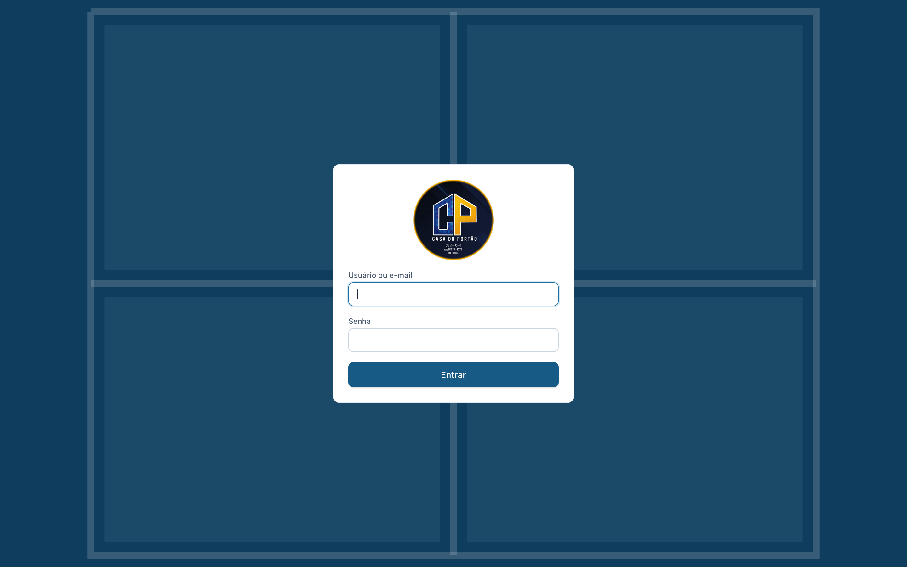

# Glass Shop ERP

Web ERP built for **Casa do Portão**, a glass and aluminum shop in Brazil. It replaced a paid off-the-shelf system and covers the whole flow: quote → sale → production → delivery → finance.

**Live:** [cponline.site](https://cponline.site)

## Features

- **Quotes:** formula engine for glass and frame pricing, drawings with dimensions, mobile-friendly quotes with a public link for the customer.
- **Production:** tempering queue, cutting plan that reuses offcuts, and a production calendar.
- **Sales kanban:** quotes and sales funnel with cards created automatically.
- **Finance:** payables and receivables, bank accounts and cash, installments generated from each sale.
- **Inventory:** stock deducted on sale, stock entry by importing the supplier's NF-e XML (Brazilian e-invoice), adjustments and history.
- **Reports:** 19 reports, including income statement (DRE) and cash flow (DFC), with print and CSV export.
- Catalog of 1,200+ products synced with images.

## Stack

- **Frontend:** React, Vite, TypeScript, Tailwind, React Router
- **Backend:** Node.js, Express, Zod, JWT auth with cookies
- **Database:** PostgreSQL
- **Infra:** Docker on a Linux VPS, Nginx, Cloudflare, daily automated backups
- **Quality:** 70 automated tests

---

**About the code:** this is a client project, so the source code is private. This repository documents what was built and how. I am happy to walk through the code and architecture in a call.

Built by [José Henrique Rodrigues](https://www.linkedin.com/in/josehenriquerodrigues-dev) · SmartHelp LTDA
